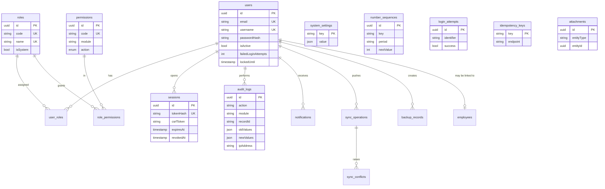
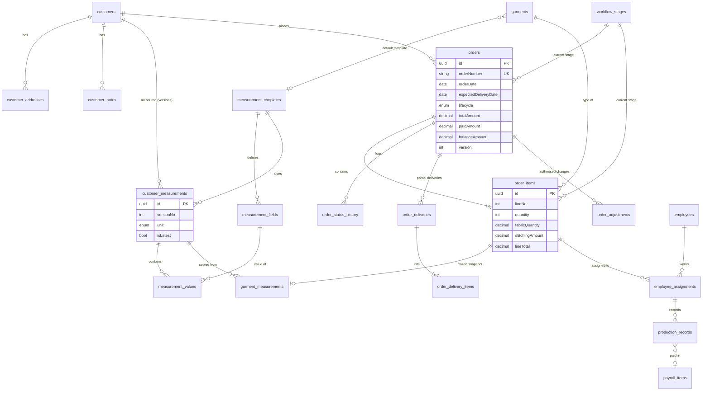
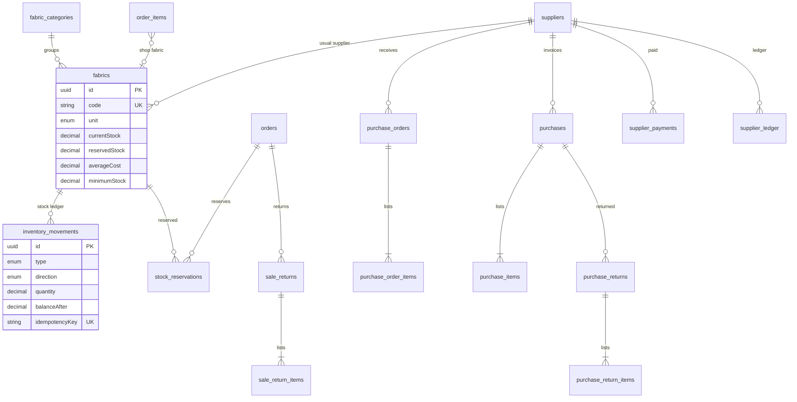
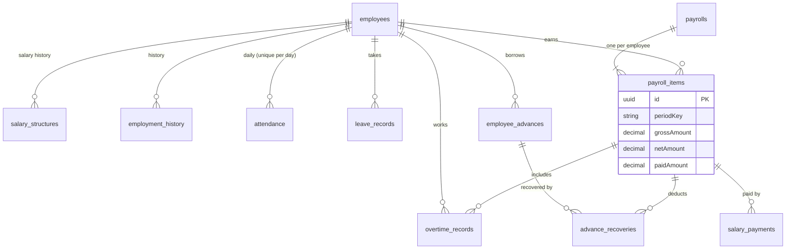
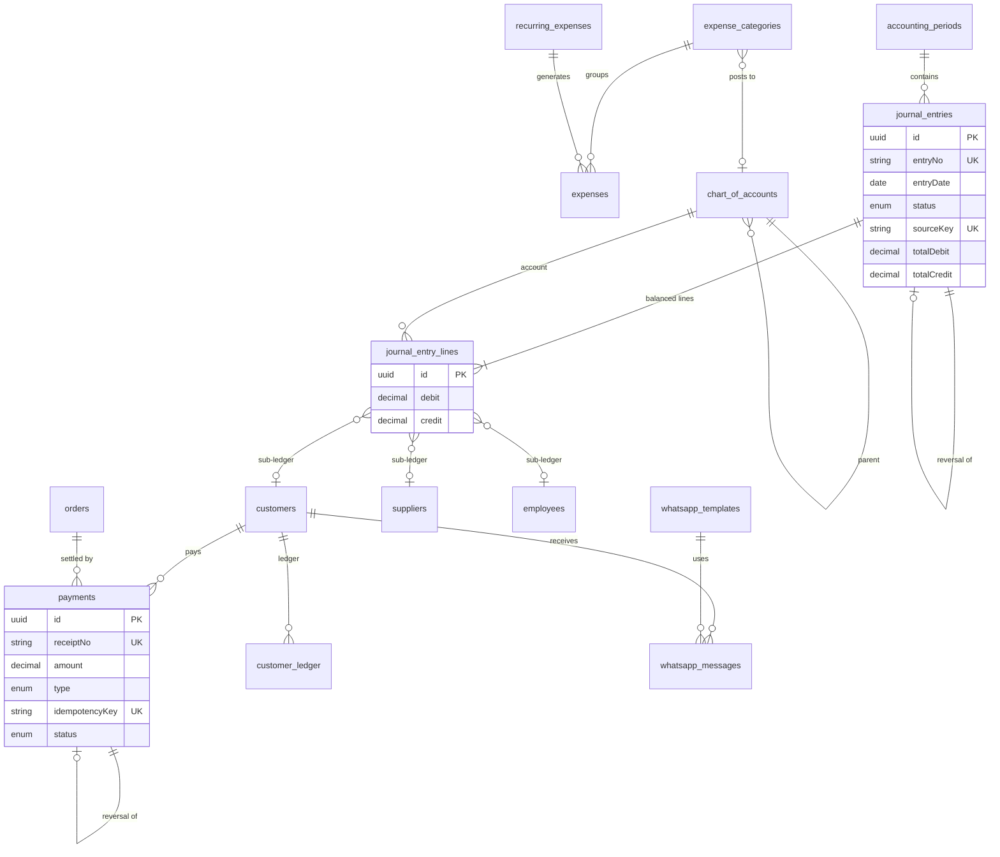

# Database ER Diagram

60 tables in PostgreSQL 16. Source of truth: `apps/backend/prisma/schema.prisma`.
Diagrams are split by domain for readability (GitHub and most Markdown viewers render Mermaid).

## 1. Security, RBAC & system

## 2. Customers, measurements, orders & production

## 3. Inventory, suppliers & purchases

## 4. Employees, attendance & payroll

## 5. Payments, expenses & accounting

