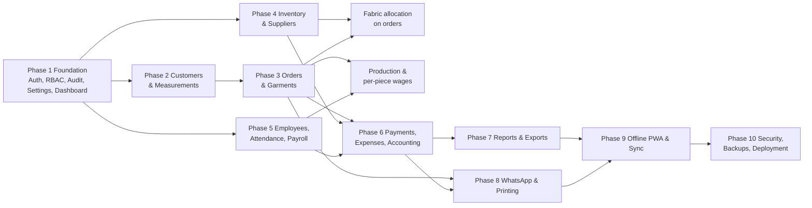

# AMIR ZAMEER ERP - Development Roadmap

Modular monolith (NestJS + PostgreSQL/Prisma + React). Each phase ends with: build, type-check,
unit + database integration tests, browser check, documentation update and a completion report.
The next phase starts only after the owner reviews the previous one.

## Module dependency graph

## Phases

| Phase | Scope | Depends on | Status |
|---|---|---|---|
| 1 Foundation | Monorepo, PostgreSQL, full Prisma schema + integrity migrations, session auth (Argon2id, HTTP-only cookies, CSRF, lockout, rate limit), RBAC (8 roles x 22 modules x 8 actions), users, roles matrix, audit log, settings, dashboard (real queries), layout & navigation, tests | - | **Done - awaiting review** |
| 2 Customers | Customer CRUD, auto codes, duplicate detection, profile tabs, measurement templates (7 garment types + custom fields), versioned measurements, comparison, print sheet | 1 | Next |
| 3 Orders & Garments | Order numbers AZ-YYYY-NNNNN, multi-garment orders, measurement snapshots, configurable workflow, status history, assignment, partial delivery, cancel/alter/revise/duplicate, receipts | 2 | Planned |
| 4 Inventory & Suppliers | Fabric master, purchases/returns, stock ledger with idempotent movements, reservations, allocation/consumption/reversal, low stock, valuation, suppliers & ledger | 1 (3 for allocation) | Planned |
| 5 Employees & Payroll | Employees, salary history, attendance, leave, overtime, advances, production records, payroll (monthly/daily/per-piece/fixed+incentive), slips | 1, 3 | Planned |
| 6 Finance & Accounting | Customer payments & ledger, refunds, expenses + approvals, supplier payments, chart of accounts, automatic double-entry posting, periods, P&L, balance sheet, cash flow | 3, 4, 5 | Planned |
| 7 Reports | All 30 reports with filters, pagination, sorting, column visibility, Excel/CSV/PDF export, print | 6 | Planned |
| 8 WhatsApp & Printing | Meta Cloud API (templates, webhooks, status, retries, opt-in), manual fallback, A4 invoices, 58/80 mm receipts | 3, 6 | Planned |
| 9 Offline PWA | Workbox, IndexedDB (Dexie), offline forms, sync queue, idempotent sync API, conflict review | 2-6 | Planned |
| 10 Security & Deployment | Security/performance tests, encrypted automated backups + restore test, VPS, Docker, SSL, docs, handover | all | Planned |

## Design decisions already locked in (Phase 1)

* **UUID primary keys** everywhere so offline devices can create records safely (Phase 9).
* **Money = DECIMAL(14,2)**, fabric = DECIMAL(12,3), measurements = DECIMAL(7,2). No floats.
* **Database-enforced rules** (not only application code): append-only audit log, inventory ledger,
  customer/supplier ledgers and measurement versions; journal entries must balance to post and are
  immutable once posted; payments cannot be deleted; idempotency keys on payments, stock movements,
  expenses, advances and salary payments; one payroll per employee per month.
* **Session auth** with server-side sessions table (instant logout / deactivation), not JWT.
* Shared module + permission catalogue in `packages/shared` used by both backend and frontend.
